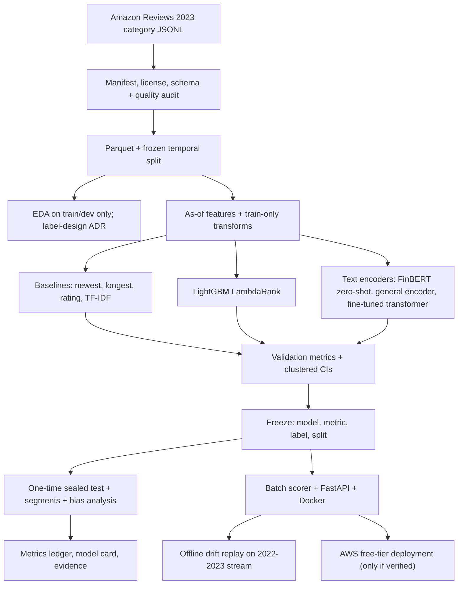

# ReviewRank — Architecture and data contracts

## End-to-end flow



## Field contract

| Field | Allowed use | Forbidden / caveat |
|---|---|---|
| `text`, `title` | Text features and encoders | Raw text not published in repo |
| `rating` | Feature (extremity, agreement with as-of product mean) | Product mean must be as-of posting time |
| `verified_purchase` | Feature | Flag: 90.1% true in sample, little variance |
| `images` | Feature: count/presence | — |
| `timestamp` | Split, grouping, limited calendar features | Must not let model infer review age at snapshot |
| `asin` / `parent_asin` | Query-group key; as-of aggregates | Product popularity is a confound; grouping controls it |
| `user_id` | Leakage check (same-user overlap across split); optional as-of reviewer stats | Never a feature that uses future reviews |
| `helpful_vote` | Label construction only (relevance grade) | Never a feature; never in any derived feature |
| Snapshot date | Maturity rule | Determine from max timestamp in data; record |

## Data and model interfaces

| Artifact | Required fields | Invariant |
|---|---|---|
| Source manifest | URL, license note, download time, bytes, sha256, rows, schema | Immutable; raw data outside Git |
| Audit report | Missing/empty text, duplicates, language guess, time coverage, vote-age curve, product concentration | No silent removal; every exclusion counted by reason |
| Split manifest | Seed, date boundaries, row counts per split, group counts, hash | Boundaries fixed before modeling; test unqueried |
| Label table | review id, group id, vote, relevance grade, eligibility flag, maturity flag | Built by one documented function; unit-tested |
| Feature matrix | review id, split, feature columns, transform version | No votes/derived votes; as-of only |
| Prediction table | run id, split, review id, group id, score, rank, grade | Unique row; same rows across models being compared |
| Metric report | NDCG@k, P@k, groups evaluated, coverage, CI method, baselines | Same rows and groups for every model |
| Model artifact | model file, feature schema, transform version, commit, source hash | Scorer refuses unknown/missing features |
| Scoring service | review text/title/rating/verified/image count/timestamp + product key | Rejects forbidden fields (votes) |

## Suggested repository layout

```text
README.md
pyproject.toml
Dockerfile
configs/{project.yaml,splits.yaml,eval.yaml}
data/{raw,processed}/                # Git-ignored
artifacts/{models,predictions}/      # large files ignored; manifests committed
docs/planning/{01_ROADMAP,02_ARCHITECTURE,03_METRICS_AND_DECISIONS}.md
docs/{problem_contract,model_card}.md
reports/{audit,eda,baselines,validation,test,bias,monitoring}/
src/reviewrank/{acquire,validate,split,labels,features,models,evaluate,bootstrap,serve,monitor}.py
tests/{test_split,test_labels,test_leakage,test_ndcg,test_bootstrap,test_api_parity}.py
```

## Stack

- **Python 3.11**, **DuckDB + Parquet** for the 494k-row category (and any larger one), pandas only where bounded.
- **scikit-learn** (TF-IDF, linear models), **LightGBM** (LambdaRank), **Hugging Face Transformers + PyTorch** (FinBERT, general encoder, fine-tuning), **scipy/numpy** for bootstrap.
- **FastAPI + Docker** for serving; **pytest** for tests; YAML configs and run manifests tie every number to code, data hash and parameters.
- **AWS (free tier only, verify terms first):** S3 for model artifact, Lambda container image or equivalent for the API, CloudWatch logs, an AWS Budgets alarm. "Deployed on AWS" on the resume only after it is live and verified.
- Hardware: Windows; GPU not yet checked.

## Evaluation design

1. Queries are (product, window) groups; metric is NDCG@3 averaged across eligible groups, with coverage (share of groups/reviews eligible) reported beside it.
2. Every model scores exactly the same rows and groups. Ties broken with a fixed seed.
3. Confidence intervals: **bootstrap over products** (clusters), because reviews within a product are not independent. Paired difference vs each baseline uses the same resampled products.
4. Report segment metrics (rating, length bucket, verified, group size) and a "does it just pick long/extreme reviews?" check.
5. Choose on validation only; write the freeze record; open the test once.

## Verification gates (tests that must exist)

1. Synthetic ranking fixture where the correct NDCG is known by hand; implementation must match.
2. Leakage fixture: a column derived from `helpful_vote` in the feature matrix raises an error.
3. Future-aggregate fixture: product mean computed with a later review fails the as-of test.
4. Age-confound fixture: a model given only review age gets a measurable score; the pipeline must show that calendar features do not just recover this (ablation recorded).
5. Split manifest deterministic and disjoint in time; hash change invalidates cached features.
6. Product-clustered bootstrap coverage checked on a synthetic case.
7. API and batch scores match to numeric tolerance; forbidden fields rejected; malformed input rejected.
8. Every comparison uses identical rows, groups and tie rule.

## Initial architecture decisions

| ID | Choice | Revisit if |
|---|---|---|
| ADR-001 | Rank product reviews (real text, real timestamps, a real if imperfect outcome) | A stronger verified dataset appears |
| ADR-002 | Ranking (NDCG) not classification accuracy | Stakeholder decision contract changes before test |
| ADR-003 | Temporal split with maturity rule | Stage 2 shows vote-age curve requires different dates (before modeling) |
| ADR-004 | Graded within-group relevance, not raw votes | EDA shows degenerate groups; fix before modeling |
| ADR-005 | Baseline ladder before LightGBM before transformer | A simpler model wins on validation |
| ADR-006 | Product-clustered bootstrap CIs | Cluster structure changes |
| ADR-007 | Local reproducible demo before any AWS deployment | AWS terms verified and cost-safe |

Record measured decisions and rejected alternatives in `03_METRICS_AND_DECISIONS.md`.
