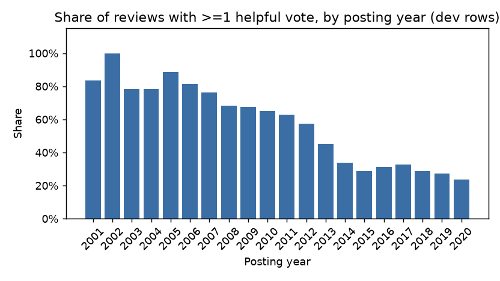
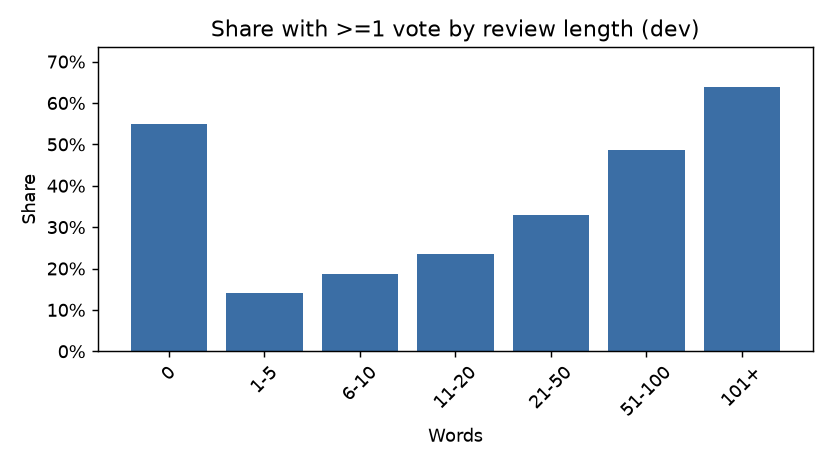
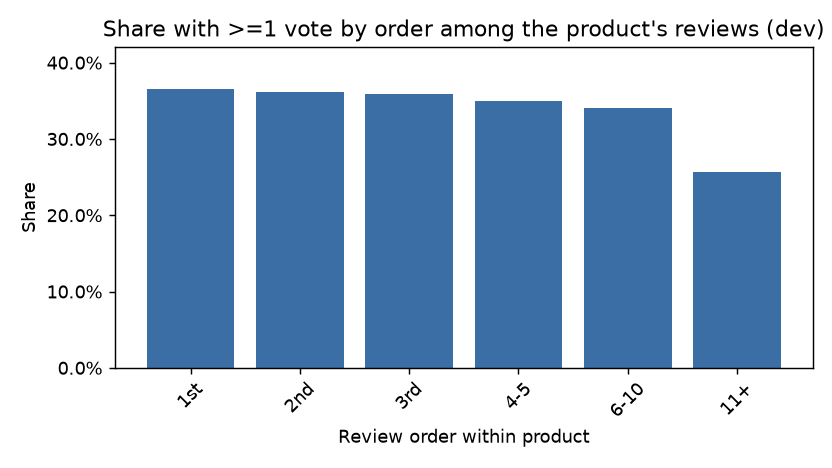
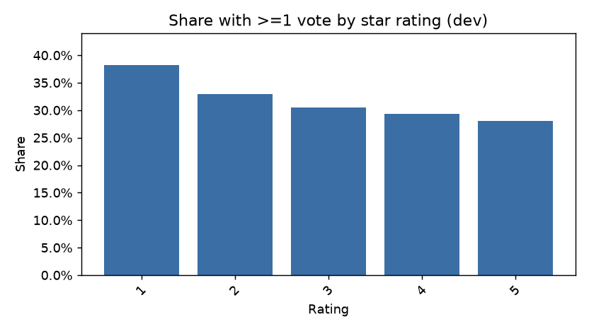
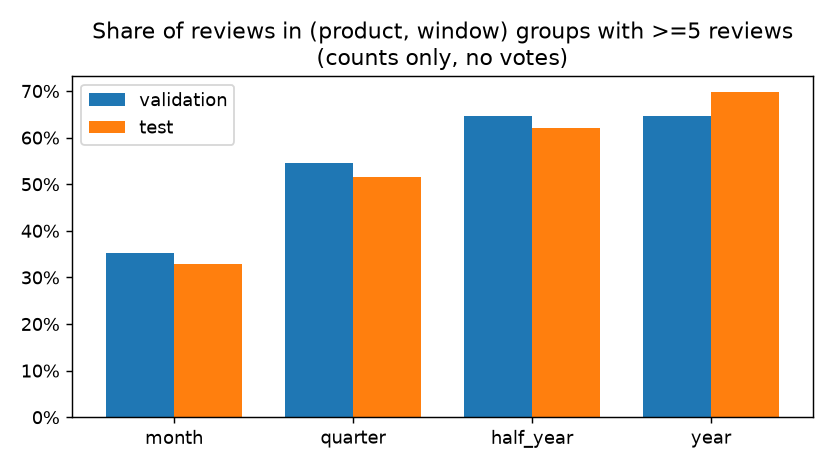

# ReviewRank — EDA findings (Stage 2, 2026-09-30)

**Rule:** anything that uses `helpful_vote` here is computed on development rows only (posted before 2021-01-01). The sealed test year was not used with labels. Numbers come from `reports/eda/eda.json` and `reports/eda/followups.json` (`scripts/stage2_audit_eda.py`). Development rows: 369,790 (before cleaning).

**Disclosure:** the earlier feasibility check (before the split existed) printed the share of reviews with ≥1 vote for every year, including 2021 (22.1%), 2022 (24.9%) and 2023 (19.2%). That was an aggregate, descriptive rate; no model used it and no row-level test labels have been inspected.

## EDA-01 — Vote rate versus posting year (changed the training start)

| Year | 2010 | 2012 | 2013 | 2014 | 2015 | 2016 | 2017 | 2018 | 2019 | 2020 |
|---|---|---|---|---|---|---|---|---|---|---|
| Share with ≥1 vote | 64.9% | 57.3% | 44.9% | 33.7% | 28.9% | 31.2% | 32.6% | 28.6% | 27.4% | 23.7% |

**Observation:** a steep decline up to 2014, then roughly flat at 27–33% over 2015–2019, and 23.7% in 2020.
**Alternative explanations:** reviews that have had more time collect more votes; vote competition grows as review volume rises (1,495 reviews in 2010 vs 76,753 in 2020); old reviews that survive in the data are a selected sample.
**Correction of my earlier belief:** the feasibility view suggested a steady fall to 2020. The fuller view shows the age effect is strong in old years and much weaker afterwards.
**Decision:** training starts 2015-01-01 (ADR-010, 36,713 rows set aside); compare reviews only within a half-year product group (ADR-011).
**Check that could reverse it:** Stage 6 ablation with pre-2015 reviews included; Stage 8 comparison of H1 vs H2 2021 on the test.

## EDA-02 — Length is the strongest simple signal (changed the baseline plan)

| Words | 1–5 | 6–10 | 11–20 | 21–50 | 51–100 | 101+ |
|---|---|---|---|---|---|---|
| Share with ≥1 vote | 14.0% | 18.6% | 23.5% | 33.0% | 48.7% | 63.9% |
| Mean votes | 0.27 | 0.40 | 0.58 | 1.06 | 2.28 | 6.41 |

**Decision:** "longest-first" is a mandatory baseline and is expected to be hard to beat. A model must be judged against it on identical groups; any gain over TF-IDF alone is not enough to claim.

## EDA-03 — Order within product (mild first-mover effect)

| Order among the product's reviews | 1st | 2nd | 3rd | 4–5 | 6–10 | 11+ |
|---|---|---|---|---|---|---|
| Share with ≥1 vote | 36.5% | 36.2% | 35.9% | 35.0% | 34.0% | 25.6% |

**Observation:** a small, steady decline over the first ten reviews (about 2.5 points); the larger drop at 11+ is entangled with calendar time and product popularity.
**Decision:** as-of review order (number of earlier reviews on the product) is an allowed feature but is ablated, because it is also a proxy for age and exposure. Position/exposure bias stays a documented limitation.

## EDA-04 — Votes are concentrated (changed the label design)

- 70.0% of reviews have zero votes; the top 1% of reviews hold 40.0% of all votes.
- Median share of a product's votes captured by its single top review: 42.9% (10,689 products with ≥5 development reviews and at least one vote).
- Grade mass on development rows: 0 votes 70.0%, 1 vote 14.9%, 2–4 votes 9.9%, 5+ votes 5.3% (2015 and later: 71.6 / 14.6 / 9.2 / 4.7).

**Decision:** graded relevance 0/1/2–4/5+ (ADR-012) so every grade has real mass; NDCG with exponential gain rewards the rare top reviews; a binary "≥1 vote" version is a sensitivity analysis.

## EDA-05 — Rating, verification and images

| | 1★ | 2★ | 3★ | 4★ | 5★ |
|---|---|---|---|---|---|
| Share with ≥1 vote | 38.2% | 33.0% | 30.5% | 29.4% | 28.1% |

| Verified purchase | Has image | Reviews | Share with ≥1 vote |
|---|---|---:|---:|
| no | no | 32,450 | 31.9% |
| no | yes | 2,389 | 45.8% |
| yes | no | 325,324 | 29.0% |
| yes | yes | 9,627 | 52.3% |

**Observation:** low ratings get slightly more votes; reviews with images get far more; being verified adds little by itself.
**Decision:** image presence is a candidate feature; "rating extremity" is weaker than expected, so it stays a baseline but is not assumed to help.

## EDA-06 — Group sizes decided the evaluation unit

With half-year groups of at least 5 reviews, about 62–65% of reviews are covered; validation has 1,914 such groups and test 3,070 (counts only, before cleaning). Monthly windows cover only 33–35% of reviews; yearly windows cover about 70% but mix wider age differences. **Decision:** half-year windows, minimum group size 5, with sensitivity at 3 and 10 and quarterly windows (ADR-011). Full table in `reports/audit/data_quality.md`.

## Other plots

- `01_reviews_per_year.png` — review volume per year (peaks in 2020).
